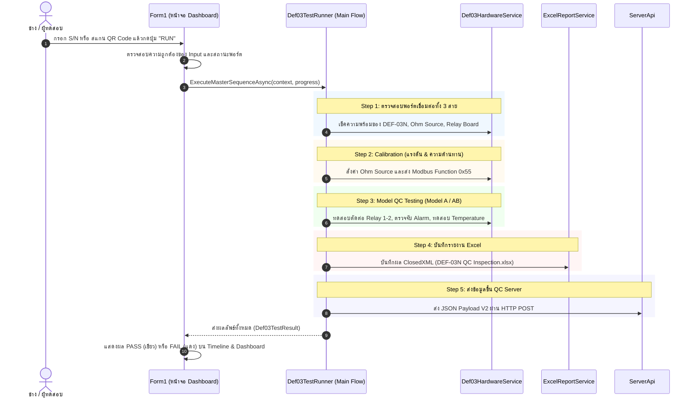

# DEF-03N Test Program - Developer & Architecture Guide 📘
> คู่มือโครงสร้างสถาปัตยกรรมและแนวทางการดูแล/แก้ไขโค้ดสำหรับโปรแกรมเมอร์ (DEF-03N Test Suite)

โปรแกรมนี้ได้รับการออกแบบตามแนวคิด **Orchestrator Pattern** และ **Separation of Concerns (SoC)** โดยแยกส่วนติดต่อผู้ใช้ (UI Dashboard), ลำดับขั้นตอนการทดสอบ (Master Test Sequence), ฮาร์ดแวร์และการสื่อสาร (Modbus/Relay/Ohm), การออกรายงาน Excel (ClosedXML), และการเชื่อมต่อ QC Server API ออกจากกันอย่างเป็นระบบ

---

## 1. แผนผังโครงสร้างโปรเจกต์ (Project Directory Layout)

```text
TEST_DEF-03N/
│
├── 1. Services/ (ระบบ Logic และฟังก์ชันการทำงานหลัก)
│   ├── Def03TestRunner.cs                   # ★ [Main Orchestrator] ผู้บัญชาการขั้นตอนทดสอบทั้งหมด (Master Sequence)
│   ├── Def03HardwareService.cs              # [ฮาร์ดแวร์] รวม Modbus RTU, CRC16, บอร์ด Relay, Ohm Source
│   ├── ExcelReportService.cs                # [เอกสาร] รวม ClosedXML, ตรวจ S/N ซ้ำ, ตรวจสอบสถานะไฟล์
│   └── ButtonTestRunner.cs                  # ระบบตรวจสอบการกดปุ่มหน้าจอแบบ Asynchronous
│
├── 2. UI/ (งานหน้าจอและดีไซน์ทั้งหมด)
│   ├── Controls/                            # Custom UI Controls สไตล์ Modern
│   │   ├── CustomTextBox.cs                 # กล่องข้อความพร้อม Placeholder
│   │   ├── CustomComboBox.cs                # กล่อง Dropdown สไตล์โมเดิร์น
│   │   ├── CustomCheckBox.cs                # กล่อง Checkbox ดีไซน์พิเศษ
│   │   ├── CustomRoundedButton.cs           # ปุ่มกดขอบโค้งพร้อมสี Hover
│   │   ├── CustomLine.cs                    # เส้นคั่นแบ่งโซน
│   │   ├── MyRoundedPanel.cs                # แผง Panel ขอบมน
│   │   └── StepTimelineControl.cs           # เส้น Timeline แสดงขั้นตอนการทดสอบ
│   └── Forms/                               # หน้าต่าง Popup Dialogs
│       ├── LoginForm.cs                     # หน้าต่างล็อกอินผู้ทดสอบ (Operator Login) & ตั้งค่า Server IP
│       ├── DescriptionForm.cs               # หน้าต่างคำอธิบายและแนวทางการทดสอบ
│       ├── EquipmentPopupForm.cs            # หน้าต่างจัดการเครื่องมือวัด (DMM, Power Supply, Calibrator)
│       ├── HelpPopupForm.cs                 # หน้าต่างคู่มือช่วยเหลือการใช้งาน
│       └── ParameterPopupController.cs      # คอนโทรลเลอร์ควบคุม Popup ตั้งค่าพารามิเตอร์
│
├── 3. Models/ (คลาสโครงสร้างข้อมูล Data Models)
│   ├── QcApiModels.cs                       # โมเดลข้อมูลสำหรับส่งขึ้น QC Server API
│   ├── ModelTestResults.cs                  # เก็บผลการทดสอบแต่ละ Step (Model A / Model AB)
│   ├── EquipmentRecord.cs                   # ข้อมูลประวัติและรหัสเครื่องมือวัด
│   └── QcReportLayout.cs                    # นิยามพิกัดเซลล์และคอลัมน์ของรายงาน Excel
│
├── 4. Form1 (ศูนย์บัญชาการ UI Dashboard)
│   ├── Form1.cs                             # ผูกชิ้นส่วน Services เข้าด้วยกัน (Composition Root)
│   ├── Form1.Designer.cs                    # โค้ดสร้างคอนโทรล WinForms
│   ├── Form1.Barcode.cs                     # จัดการ Event สแกนเนอร์บาร์โค้ด / QR Code
│   ├── Form1.EquipmentApi.cs                # จัดการบันทึกเครื่องมือวัดและส่งผล QC API
│   ├── Form1.QcPayloadV2.cs                 # ตัวแปลงผลการตรวจเป็น JSON Payload Schema V2
│   ├── Form1.ServerAddress.cs               # จัดการตั้งค่า IP/Port ของเซิร์ฟเวอร์
│   ├── Form1.Help.cs                        # หน้าต่าง Help และ Shortcut
│   ├── Form1.Login.cs                       # จัดการ Session ล็อกอิน
│   └── Form1.DebugShortcut.cs               # คีย์ลัดสำหรับการ Debug
│
├── DEF-03N QC Inspection.xlsx               # ไฟล์เทมเพลต Excel มาตรฐาน
├── README_DEVELOPER.md                      # ไฟล์คู่มือนี้
└── TEST_DEF-03N.csproj                      # ไฟล์คอนฟิกโปรเจกต์ .NET 8.0-windows
```

---

## 2. Quick Lookup: "อยากแก้อะไร... ต้องไปดูที่ไฟล์ไหน?" 🔍

| สิ่งที่ต้องการแก้ไข | ไฟล์ที่ต้องไปแก้ไข | รายละเอียด |
| :--- | :--- | :--- |
| **ขั้นตอนการทดสอบหลัก (Master Sequence)** | `Services/Def03TestRunner.cs` | ต้องการเพิ่มขั้นตอน, เปลี่ยนลำดับ, หรือสลับเงื่อนไขผ่าน/ตก |
| **การสื่อสาร Modbus, CRC16, คำสั่ง Register** | `Services/Def03HardwareService.cs` | คำนวณ CRC16, ฟังก์ชัน 0x03, 0x06, 0x55 (Calibration) |
| **การสั่งบอร์ด Relay / Alarm / Ohm Source** | `Services/Def03HardwareService.cs` | คำสั่งตัดต่อ Relay, เช็ค Alarm, หรือการสร้างไบต์ส่ง Ohm Source |
| **การตรวจ S/N ซ้ำ (Duplicate Check)** | `Services/ExcelReportService.cs` | เมธอด `CheckDuplicateSN()` ตรวจในไฟล์ Excel ของ LOT |
| **การตรวจสอบไฟล์ Excel ถูกเปิดค้าง** | `Services/ExcelReportService.cs` | เมธอด `EnsureReportFileClosed()` ป้องกันโปรแกรมค้าง |
| **รูปแบบบาร์โค้ด / QR Code** | `Form1.Barcode.cs` | แก้ไขการตัดเครื่องหมายจุลภาค, หรือการสกัด Model, LOT, S/N |
| **การส่งข้อมูลขึ้น Server (QC API)** | `Form1.EquipmentApi.cs` | URL Endpoint, การส่ง HTTP POST, หรือจัดการ Retry |
| **โครงสร้างข้อมูล JSON Schema V2** | `Form1.QcPayloadV2.cs` | ฟิลด์ข้อมูลที่ส่งเข้า Server, ค่า Approve, Firmware, Power Supply |
| **IP และ Port ของ Server** | `Form1.ServerAddress.cs` | ค่า Default Server IP / Port และการแปลง Uri |
| **ข้อมูลเครื่องมือวัด (DMM, Calibrator)** | `UI/Forms/EquipmentPopupForm.cs` | รายการอุปกรณ์ใน Popup และการบันทึกลง Settings |
| **หน้าตา ปุ่มกด สี หรือกล่องข้อความ** | `UI/Controls/` | ปรับดีไซน์ขอบโค้ง (BorderRadius), สีขอบ (BorderColor), หรือ Font |
| **การเชื่อมต่อพอร์ต Serial บนหน้าจอ** | `Form1.cs` | การเลือก Port DEF-03N, Ohm Port, Relay Port |

---

## 3. สถาปัตยกรรมการทำงาน (Control Flow)



---

## 4. ลำดับขั้นตอนการทดสอบของ `Def03TestRunner`

ทุกขั้นตอนถูกร้อยเรียงไว้อย่างชัดเจนใน `Services/Def03TestRunner.cs`:

1. **Step 1: ตรวจสอบพอร์ตและข้อมูลนำเข้า**
   - ตรวจสอบว่าพอร์ตสื่อสารทั้ง 3 สาย (DEF-03N Serial, Ohm Port, Relay Port) เปิดพร้อมทำงาน
   - ตรวจสอบความถูกต้องของ S/N, LOT Number, และโฟลเดอร์ปลายทาง
   - ตรวจสอบว่าไฟล์ Excel ของ LOT นั้นไม่ได้เปิดค้างอยู่ในโปรแกรมอื่น
2. **Step 2: ดำเนินการ Calibration**
   - สั่งค่า Ohm Source ไปยังพอร์ตโอห์ม
   - ส่งเฟรมคำสั่ง Modbus Function `0x55` สำหรับปรับเทียบแรงดันและความต้านทาน
3. **Step 3: ดำเนินการทดสอบ QC ตาม Model**
   - **Model A**: ทดสอบ Contact 1 คู่, สัญญาณเตือน Alarm, และการวัดอุณหภูมิตามย่านที่กำหนด
   - **Model AB**: ทดสอบ Contact 2 คู่ (A และ B), สัญญาณเตือน Alarm ทั้งสองชุด, และการวัดอุณหภูมิครบทุกจุด
4. **Step 4: บันทึกรายงาน Excel**
   - นำผลการวัดทั้งหมดลงไฟล์รายงาน Excel ประจำ LOT โดยใช้ ClosedXML
5. **Step 5: ส่งผลขึ้นระบบ QC Server**
   - แปลงข้อมูลเป็น Schema V2 แล้วส่งผ่าน HTTP POST ไปยังเซิร์ฟเวอร์ฐานข้อมูลโรงงาน

---

## 5. แนวปฏิบัติที่ดีสำหรับผู้พัฒนาต่อยอด (Best Practices)

- **อย่าใส่สูตรคำนวณในหน้า Form1 โดยตรง**:
  หากมีเงื่อนไขการทดสอบใหม่ ให้เขียนเป็น Method ใน `Def03TestRunner.cs` หรือ `Def03HardwareService.cs` แล้วให้ Form1 ส่ง Event/Progress ไปแสดงผลเท่านั้น
- **การจัดการ Thread Safety**:
  เนื่องจากการทดสอบทำงานแบบ Asynchronous (`async/await`) การแตะต้อง UI Controls ต้องทำผ่าน `Invoke` / `BeginInvoke` หรือ `IProgress<T>` เสมอ
- **การคอมไพล์โปรเจกต์**:
  ใช้คำสั่ง:
  ```powershell
  dotnet build "TEST_DEF-03N.csproj"
  ```
  โดยกำหนด Target Framework เป็น `.NET 8.0 Windows`
