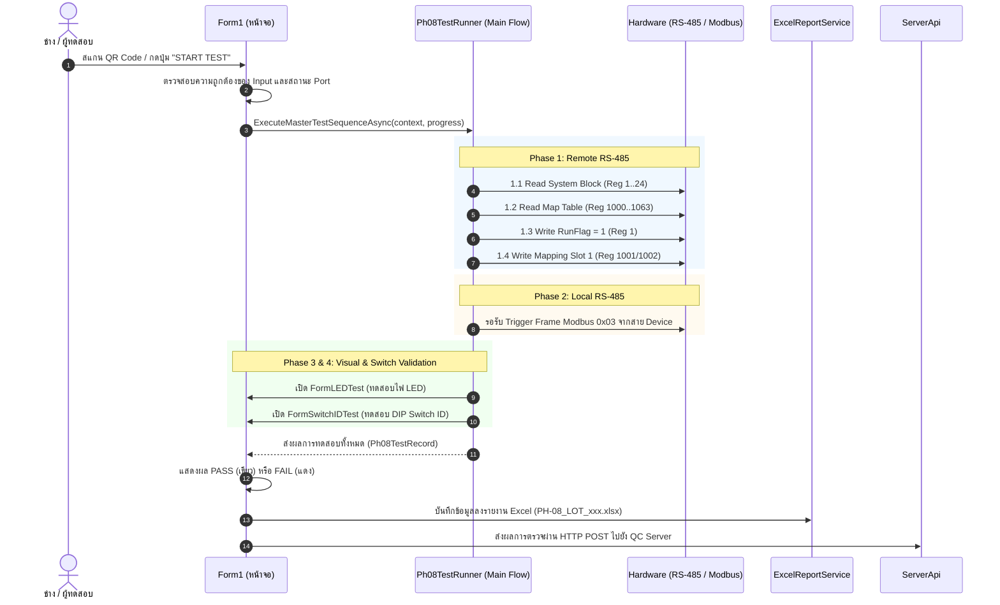

# PH-08 Test Program - Developer & Architecture Guide 📘
> คู่มือโครงสร้างสถาปัตยกรรมและแนวทางการดูแล/แก้ไขโค้ดสำหรับโปรแกรมเมอร์

โปรแกรมนี้ได้รับการออกแบบตามแนวคิด **Orchestrator Pattern** และ **Separation of Concerns (SoC)** โดยแยกส่วนติดต่อผู้ใช้ (UI), ขั้นตอนการทดสอบ (Master Test Sequence), และฟังก์ชันเฉพาะทาง (Hardware, Excel, Server API, Barcode) ออกจากกันอย่างเป็นสัดส่วน

---

## 1. แผนผังโครงสร้างโปรเจกต์ (Project Structure)

```text
PH-08 Test/
│
├── Models/                                  # คลาสโครงสร้างข้อมูล (Data Models)
│   ├── Ph08TestRecord.cs                    # เก็บผลการทดสอบทุก Phase และสถานะ Pass/Fail
│   └── QcApiModels.cs                       # ข้อมูลสำหรับส่งขึ้น QC Server API
│
├── Services/                                # ฟังก์ชันระบบเฉพาะทาง (ไม่ขึ้นกับหน้าจอ UI)
│   ├── Orchestrator/
│   │   └── Ph08TestRunner.cs                # ★ Main หลักที่เขียนขั้นตอนการทดสอบทั้งหมด (Master Sequence)
│   ├── Reporting/
│   │   └── ExcelReportService.cs            # บันทึก ClosedXML, จัดการ Template, ตรวจจับ S/N ซ้ำ
│   ├── Barcode/
│   │   └── BarcodeParser.cs                 # แกะข้อความจากการสแกน QR/Barcode (Model, ECN, Lot, SN)
│   └── Hardware/
│       └── ModbusCrc16.cs                   # คำนวณและตรวจสอบ Modbus RTU CRC16
│
├── UI/                                      # งานดีไซน์และหน้าต่างทั้งหมด
│   ├── Controls/                            # Custom UI Components สไตล์ Modern
│   │   ├── CustomTextBox.cs                 # กล่องข้อความโค้งมน พร้อม Placeholder
│   │   ├── CustomComboBox.cs                # กล่อง Dropdown สไตล์โมเดิร์น
│   │   ├── CustomRoundedButton.cs           # ปุ่มกดขอบโค้งพร้อมสี Hover
│   │   ├── CustomRichTextBox.cs             # กล่องแสดง Log สี
│   │   ├── CustomRoundedPanel.cs            # แผงกล่องข้อความขอบมน
│   │   ├── CustomLine.cs                    # เส้นคั่นดีไซน์
│   │   ├── AvatarPillButton.cs              # ปุ่มโปรไฟล์ผู้ใช้งาน
│   │   └── ConnectionStatusBadge.cs         # ป้ายสถานะการเชื่อมต่อ
│   └── Forms/                               # หน้าต่าง Popup และ Dialogs
│       ├── FormLEDTest.cs                   # หน้าต่างทดสอบไฟ LED 6 ตำแหน่ง
│       ├── FormSwitchIDTest.cs              # หน้าต่างทดสอบ DIP Switch ID 8-bit
│       ├── FormParameter.cs                 # หน้าต่างตั้งค่าพารามิเตอร์ PH-08
│       ├── FormLogin.cs                     # หน้าต่างล็อกอินผู้ทดสอบ (Operator Login)
│       └── FormSerialSettingsPopup.cs       # หน้าต่างตั้งค่า Baudrate, Parity, StopBits
│
├── Form1 (ศูนย์บัญชาการ UI / แดชบอร์ดหลัก)
│   ├── Form1.cs                             # ผูกชิ้นส่วน Service เข้าด้วยกัน (Composition Root)
│   ├── Form1.Designer.cs                    # โค้ดสร้างคอนโทรล WinForms
│   ├── Form1.Test.cs                        # จัดการปุ่ม Start Test, อัปเดตสี/สถานะบนหน้าจอ
│   ├── Form1.PH08.cs                        # จัดการพอร์ต Serial ของ PH-08 และ Polling Timer
│   ├── Form1.Device.cs                      # จัดการพอร์ต Serial ของ Device
│   ├── Form1.Barcode.cs                     # จัดการ Event การพิมพ์/สแกนบาร์โค้ด
│   ├── Form1.Excel.cs                       # จัดการปุ่มเปิดโฟลเดอร์ และบันทึก/โหลด app_config.txt
│   ├── Form1.ServerApi.cs                   # จัดการส่งผลการทดสอบผ่าน HTTP POST ไปยัง Server
│   └── Form1.Login.cs                       # จัดการ Event ล็อกอิน/ล็อกเอาต์
│
├── README_DEVELOPER.md                      # ไฟล์คู่มือนี้
└── PH-08 Test.csproj                        # ไฟล์คอนฟิกโปรเจกต์ .NET 8.0-windows
```

---

## 2. Quick Lookup: "อยากแก้อะไร... ต้องไปดูที่ไฟล์ไหน?" 🔍

| สิ่งที่ต้องการแก้ไข | ไฟล์ที่ต้องไปแก้ไข | รายละเอียด |
| :--- | :--- | :--- |
| **ขั้นตอนการทดสอบ (Test Steps)** | `Services/Orchestrator/Ph08TestRunner.cs` | ต้องการเพิ่ม Phase, เปลี่ยนลำดับ, เปลี่ยน Timeout, หรือเปลี่ยน Register ที่อ่าน/เขียน |
| **เงื่อนไข Pass/Fail และเกณฑ์ Min/Max** | `Services/Orchestrator/Ph08TestRunner.cs` | เกณฑ์ตัดสินผลของ Phase 1, Phase 2, Phase 3, Phase 4 |
| **การเขียนไฟล์ Excel & หัวตาราง** | `Services/Reporting/ExcelReportService.cs` | แก้ไข Template, แก้ช่องคอลัมน์, จัดการ Pagination, หรือสูตรสรุปยอด |
| **การตรวจจับ S/N ซ้ำ (Duplicate Check)** | `Services/Reporting/ExcelReportService.cs` | ฟังก์ชัน `CheckDuplicateSN()` สำหรับเช็คในไฟล์ Excel |
| **รูปแบบบาร์โค้ด / สแกนเนอร์** | `Services/Barcode/BarcodeParser.cs` | แก้ไข Pattern การตัดเครื่องหมาย, Prefix `S/N:`, `LOT:`, `ECN:` หรือการเรียงลำดับ |
| **การคำนวณ CRC16 Modbus** | `Services/Hardware/ModbusCrc16.cs` | ฟังก์ชันคำนวณ Checksum ของ Modbus RTU Polynomial 0xA001 |
| **การส่งข้อมูลขึ้น Server (API)** | `Form1.ServerApi.cs` | URL Endpoint, JSON Payload, API Token Headers, หรือ HTTP Timeout |
| **หน้าต่างทดสอบไฟ LED** | `UI/Forms/FormLEDTest.cs` | ปรับการคลิกเลือก LED มีปัญหา หรือเปลี่ยนหน้าตาหน้าต่าง LED |
| **หน้าต่างทดสอบ DIP Switch ID** | `UI/Forms/FormSwitchIDTest.cs` | ปรับขั้นตอน Step 1 / Step 2 ของการสับสวิตช์ |
| **หน้าตา ปุ่มกด สี หรือกล่องข้อความ** | `UI/Controls/` | ปรับดีไซน์ขอบโค้ง (BorderRadius), สีขอบ (BorderColor), หรือ Font |
| **การเชื่อมต่อ ComPort & Polling** | `Form1.PH08.cs` & `Form1.Device.cs` | Baudrate, Polling Interval 200ms, หรือ Reconnect Logic |

---

## 3. สถาปัตยกรรมการทำงาน (Control Flow)



---

## 4. ขั้นตอนการทดสอบของ `Ph08TestRunner` (Master Test Sequence)

ขั้นตอนทั้งหมดถูกเขียนเรียงลำดับจากบนลงล่างอย่างชัดเจนใน `Services/Orchestrator/Ph08TestRunner.cs`:

1. **Phase 1: ตรวจสอบสายและคำสั่ง PH-08 (Remote RS-485)**
   - **Step 1.1**: ส่งคำสั่ง Modbus Function 0x03 ขออ่าน Register `1` จำนวน `24` ค่า (ความยาวเฟรมตอบกลับ 53 Bytes รวม CRC)
   - **Step 1.2**: ส่งคำสั่ง Modbus Function 0x03 ขออ่าน Register `1000` จำนวน `64` ค่า (ความยาวเฟรมตอบกลับ 133 Bytes รวม CRC)
   - **Step 1.3**: ส่งคำสั่ง Modbus Function 0x10 สั่งเขียน Register `1` = `1` (เปิด RunFlag)
   - **Step 1.4**: ส่งคำสั่ง Modbus Function 0x10 สั่งเขียน Register `1001` = `SlaveID`, `1002` = `1` (เซ็ต Mapping Slot 1)
2. **Phase 2: ตรวจสอบสาย Device (Local RS-485)**
   - ดักรอรับเฟรมคำสั่ง Modbus Function `0x03` จากสาย Device ภายใน Timeout 3 วินาที
   - ตรวจสอบว่า `Slave ID` ในเฟรมตรงกับค่า ID ของบอร์ด PH-08 ปัจจุบัน
3. **Phase 3: ตรวจสอบไฟ LED บนบอร์ด**
   - แสดงหน้าต่าง Dialog `FormLEDTest` ให้ผู้ทดสอบตรวจเช็คสถานะไฟทั้ง 6 ดวง (PWR, STATUS, LOCAL RX/TX, REMOTE RX/TX)
4. **Phase 4: ตรวจสอบ DIP Switch ID**
   - แสดงหน้าต่าง Dialog `FormSwitchIDTest` ให้ผู้ทดสอบทำการสับสวิตช์ตาม Step 1 และ Step 2 ครบทั้ง 8 Bits

---

## 5. การพัฒนาต่อยอดและแนวปฏิบัติที่ดี (Best Practices)

- **อย่าใส่สูตรคำนวณในหน้า Form1 โดยตรง**:
  หากมีสูตรทดสอบใหม่ ให้เขียนเป็น Method ใน `Ph08TestRunner.cs` แล้วให้ Form1 ส่ง Event/Progress ไปแสดงผลเท่านั้น
- **การจัดการ Thread Safety**:
  เนื่องจากการทดสอบทำงานแบบ Asynchronous (`async/await`) การแตะต้อง UI Control ต้องทำผ่าน `Progress<T>` หรือ `Invoke` / `BeginInvoke` เสมอ
- **การคอมไพล์โปรเจกต์**:
  ใช้คำสั่ง:
  ```powershell
  dotnet build "PH-08 Test.csproj"
  ```
  โดยกำหนด Target Framework เป็น `.NET 8.0 Windows`
